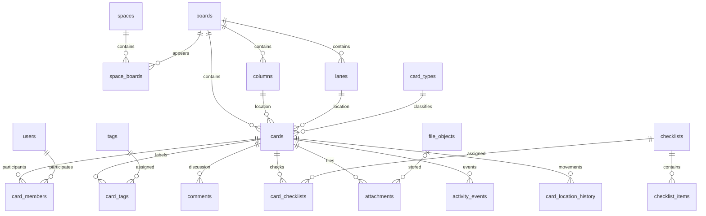

# Предложение структуры PostgreSQL для собственной доски

Статус: архитектура согласована; ядро создано миграцией `0002_board`.
Синхронизацию с Kaiten реализуем после БД и интерфейса. Новый импорт не запускался.

## Что реализовано

В `backend/app/infrastructure/database/board_models.py` определены 30 рабочих таблиц:
источники, пространства/доски, колонки/дорожки, типы, пользователи/учётные записи/роли,
карточки, участники/подписки/теги, комментарии, чек-листы и пункты, отношения,
блокировки, ссылки, определения/варианты/значения пользовательских полей,
физические файлы/вложения, история положения и события.

В PostgreSQL используются UUID, JSONB, даты с часовым поясом и точный `numeric`.
Добавлены уникальность ID внутри источника, индексы связей и лент,
проверки принадлежности расположения карточки одной доске, принадлежности вложения
комментарию/полю той же карточки, запрет самоссылок и отрицательного размера файла.
Внешние ключи не удаляют историю каскадно. Таблицы архива не менялись.

Новые таблицы пока пустые. Просмотрщик React продолжает читать существующий архив
через прежний API. Миграция создаёт только структуру; импорта, вызовов Kaiten,
демонстрационных пользователей или паролей в ней нет. SQL-репозиторий старого
архива и его 800 проверочных карточек сохранены.

Добавлен явный офлайн-скрипт [update_database.py](../update_database.py) и команда
`tools update-board`: [инструкция](UPDATE_DATABASE.md). Массовый запуск не выполнялся.
Миграция `0003_sort_order` расширяет `sort_order` до `numeric(50,25)` для фактической
точности API; размер карточки остаётся `numeric(30,10)`.

Создание/изменение, авторизация, нормализация существующего архива и синхронизация —
следующие этапы. Поле `local_version` пока подготовлено для оптимистической блокировки;
проверка версии станет обязанностью операций записи. Проверка многошаговых циклов
иерархии и соответствия значения пользовательского поля его типу будет в прикладном
слое; запрет самоссылки и внешние ключи уже действуют в БД. Редкие разделы из
раздела ниже пока не превращены в таблицы без подтверждённых контрактов.

## Основание и границы

Внутренняя схема БД Kaiten не опубликована в API. Здесь воспроизводится доступная
предметная модель, а не неизвестные таблицы производителя. За основу взяты реальные
JSON из снимка `2026-10-22_08-58-24_447787Z_board_437516` и публичная документация.
Предложение рассчитано на дальнейшее создание и редактирование собственных карточек.

Отчёт экспорта содержит 20 079 сохранённых карточек и 29 658 сохранённых файлов;
статус копии — `partial`. В каталоге карточек есть также незавершённые выгрузки.
Эти числа — отчёт экспортёра, а не гарантия полноты и не число уникальных объектов
после нормализации. Например, один файл может встречаться в нескольких ответах.

| Сохранённый источник | Что обнаружено | Следствие для модели |
| --- | --- | --- |
| `board/*.json` | 1 доска, 12 колонок, 1 дорожка, 8 типов, 48 тегов, 25 пользователей | Отдельные справочники и внешние ключи |
| `card.json` | Обычно 87–88 ключей; основные поля и вложенные копии справочников | Карточка плюс связанные сущности; не отдельные дубли board/user/tag для каждой карточки |
| `members.json` | Профиль пользователя вместе с `card_id`, `user_id`, `type` | Пользователь и участие в карточке — разные записи |
| Вложенные `tags` | Есть одновременно `id` назначения и `tag_id` тега | Таблица связей `card_tags`; нельзя считать любой вложенный `id` ID тега |
| `comments.json` | Текст, автор, формат, правки, удаление, служебные поля | Отдельная таблица комментариев, сохранение формата |
| `history.json` | История расположения: доска, колонка, подколонка, дорожка, автор, `changed` | История перемещений отдельно от текущего расположения |
| `activity.json` | `action`, `data`, автор, дата и снимки связанных объектов | Неизменяемые события, `data` в JSONB |
| `files.json` и вложенные `files` | Метаданные API и локальный манифест скачивания имеют разную структуру | Вложение и физический файл — разные сущности |
| Чек-листы и отдельные JSON чек-листов | Списки, элементы, отметки, порядок | Чек-листы, элементы и связь с карточкой |
| Блокировки | Причина, автор, блокирующая карточка, снятие блокировки | Отдельные блокировки со своим жизненным циклом |
| `fields.json`, `properties` | Определения и заполненные значения не обнаружены | Структура пользовательских полей предварительная, по API |
| `time-logs`, `iterations`, `baselines`, родительские связи | В исследованном архиве нет содержательных примеров | Поддержка по API, с отдельной проверкой на реальных данных перед реализацией |

Вложенные объекты истории могут описывать уже удалённого пользователя или старое
название колонки. Их нельзя использовать для перезаписи текущих справочников.

## Принципы хранения

1. Обычные поля и связи хранятся в типизированных столбцах и таблицах. Карточка,
   комментарий и файл — самостоятельные сущности с ключами и ограничениями.
2. JSONB используется для динамических полей, настроек, событий и исходных ответов.
   Не переносим всю рабочую модель в один JSONB и не храним только ссылки на JSON.
3. Файлы хранятся в отдельном постоянном каталоге, позже возможно S3/MinIO.
   В БД — метаданные, ключ хранения, размер и контрольная сумма. Сами бинарные данные
   в PostgreSQL не помещаем.
4. Локальные первичные ключи — UUID. Для импортированных объектов сохраняются
   `source_instance_id`, `source_id` и при наличии `source_uid`.
   Ограничение уникальности: `(source_instance_id, source_id)` в каждой сущности.
   Собственные новые объекты могут не иметь внешнего ID; ID Kaiten не является
   локальной нумерацией новых карточек.
5. Для карточек, досок, пользователей и большинства старых сущностей `source_id`
   — BIGINT. Для файлов и событий — TEXT: API может использовать числовые ID,
   строковые ID и UUID. Не преобразуем все идентификаторы через `int()`.
6. Даты событий — `timestamptz`, UTC при обмене. Для сроков сохраняется также
   признак наличия времени, чтобы срок «весь день» не стал другим днём из-за часового пояса.
   Порядок карточек — `numeric`, а не `float` с потерей точности.

## Основные таблицы

Во всех изменяемых сущностях нужны локальные `created_at`, `updated_at` и версия
для конкурентного редактирования. Времена и версия источника хранятся отдельно:
`source_created_at`, `source_updated_at`, `source_version`. Версия Kaiten не является
версией локальной записи.

| Таблица | Основные поля и связи |
| --- | --- |
| `source_instances` | `id`, `origin`, внешний ID компании, название; ссылки на конфигурацию интеграции без токена в общих API-ответах |
| `spaces` | `id`, источник, внешний ID, название, настройки JSONB |
| `boards` | `id`, источник, внешний ID, `title`, `description`, `default_card_type_id`, настройки JSONB |
| `space_boards` | `space_id`, `board_id`, размещение/порядок и настройки отображения; доска может быть доступна в нескольких пространствах |
| `columns` | `id`, `board_id`, `parent_column_id`, название, `sort_order`, тип колонки, WIP-лимиты, настройки |
| `lanes` | `id`, `board_id`, название, порядок, WIP-лимиты, тип карточки по умолчанию |
| `card_types` | `id`, источник, внешний ID, название, цвет, буква, шаблон описания, архивность, настройки полей JSONB |
| `users` | `id`, источник, внешний ID, имя, email, username, активность, признак служебного/виртуального профиля |
| `accounts` | Локальные учётные записи приложения, связь с профилем пользователя, данные входа и локальные роли; отдельная система авторизации |
| `roles`, `space_memberships` | Локальные роли и права на пространства; участие пользователя с ролью; для собственной многопользовательской доски |
| `cards` | `id`, источник, внешний ID/UID, `display_number`, `board_id`, `column_id`, `lane_id`, `type_id`, `owner_id`, название, описание, формат, порядок, приоритет, сроки, плановые даты, завершение, размер и единица, архивность/удаление |
| `card_members` | `card_id`, `user_id`, роль участия (`type` источника сохраняется явно); уникальность по карточке, пользователю и роли |
| `card_subscribers` | Подписки пользователей на карточки, если доступны в источнике/собственной доске |
| `tags` | `id`, источник, внешний ID, название, цвет, архивность |
| `card_tags` | `card_id`, `tag_id`, внешний ID назначения, даты; уникальность пары карточка–тег |
| `comments` | `id`, внешний ID/UID, `card_id`, `author_id`, текст, формат, даты, признаки edited/deleted/internal, дополнительные метаданные JSONB |
| `checklists` | `id`, внешний ID/UID, название, политика и дополнительные настройки |
| `card_checklists` | `card_id`, `checklist_id`, порядок, внешний ID связи при наличии; связь выделена, чтобы не предполагать исключительное владение списком одной карточкой |
| `checklist_items` | `id`, `checklist_id`, текст, порядок, отметка, автор отметки, ответственный, сроки, удаление |
| `card_relations` | `parent_card_id`, `child_card_id`, тип связи, источник; уникальность связи, запрет самоссылки и циклов иерархии |
| `card_blockers` | `id`, `card_id`, причина, `created_by_id`, необязательная `blocking_card_id`, срок, `released_at`, `released_by_id`, исходный released |
| `external_links` | `id`, `card_id`, URL, название/тип и прочие метаданные источника |
| `file_objects` | `id`, `storage_key`, `sha256`, размер, MIME, состояние физического файла; дедупликация по проверенному хешу и размеру |
| `attachments` | `id`, внешний ID TEXT/UID, `card_id`, необязательные `comment_id`/`property_id`, `file_object_id`, имя, автор, порядок, обложка, удаление, внешний файл, состояние скачивания |
| `card_location_history` | `id`, внешний ID TEXT, `card_id`, доска/колонка/подколонка/дорожка, автор, `changed_at`, состояние источника, исходный снимок JSONB |
| `activity_events` | `id`, внешний ID TEXT, источник, необязательный `card_id`, автор, `action`, дата, `data` JSONB и контекст события |

`users.email` не первичный ключ. Значения `permissions` и числовые маски Kaiten
сохраняются в исходных данных, но не предоставляют права в нашем приложении.

Для колонок сохраняется иерархия через `parent_column_id` (в API — `column_id`).
При записи проверяется принадлежность колонки, подколонки и дорожки одной доске;
это можно закрепить составными внешними ключами. Иерархия колонок должна быть ацикличной.
`state` карточки, тип колонки и `condition` источника не становятся тремя независимыми
редактируемыми статусами: вводится одна согласованная модель состояния, а исходные
значения сохраняются отдельно. Перемещение атомарно меняет положение и историю.

Связь с объектом, которого нет в архиве, не должна уничтожать историю. Создаём
помеченную неполную запись с известным внешним ID либо сохраняем неразрешённую ссылку
в импорте для последующего уточнения. Отсутствие карточки в очередной выборке само
по себе не является доказательством удаления.

## Пользовательские поля и редкие разделы

| Таблица | Назначение |
| --- | --- |
| `custom_properties` | Внешний ID, название, тип, архивность, правила и настройки JSONB |
| `property_options` | Варианты перечислений, если тип API использует самостоятельные варианты с ID |
| `card_property_values` | `card_id`, `property_id`, типизированное по определению значение JSONB; уникальная пара |
| `time_logs` | Карточка, пользователь, дата/интервал, длительность и описание; единицы сверить с ответом конкретного API |
| `iterations`, `card_iterations` | Итерации и участие карточек; точные поля уточнить на непустых ответах |
| `baselines`, `baseline_items` | Зафиксированные состояния/плановые значения; точные связи уточнить по данным |
| `sla_records` | Результаты SLA, только если доступны по тарифу и нужны приложению |

Дополнительные связи, которые потребуются при воспроизведении соответствующих
функций: теги по умолчанию доски/колонки/дорожки, разрешённые пользователи карточки,
участники и категории блокировки, доступность пользовательских полей по типам карточек.
Их выделяем в таблицы связей при реализации соответствующего модуля. Произвольные
`settings` и служебные ключи API сначала сохраняются в JSONB, а не теряются из-за
отсутствия выделенного столбца.

Пустой ответ не означает отсутствия сущности в Kaiten. В частности, SLA в выгрузках
возвращал HTTP 402; нельзя создавать фиктивные нулевые показатели. Эти модули
не нужно включать в первую миграцию без проверки контрактов и потребности.

Для стандартных полей карточек не применяется универсальная EAV-модель.
`card_property_values.value` валидируется по определению поля; часто используемые
типы и фильтры позднее могут получить выделенные индексы/представления.

## Файлы

Метаданные оригинала содержат `url`, `thumbnail_url`, `author_id`, `comment_id`,
`custom_property_id`, `card_cover`, `deleted`, MIME и размер. Локальный манифест
добавляет `path`, `status`, `sha256`. Это независимые сведения: наличие записи API
не означает успешного скачивания.

Связь вложения с комментарием или пользовательским полем проверяется на принадлежность
той же карточке. Файл без локального содержимого остаётся видимым с состоянием
`missing`/`failed`/`external` и причиной. Успешная загрузка сверяется по размеру и хешу.
Для будущих замен содержимого можно добавить версии вложений, не перезаписывая
старый `file_object`.

Новый механизм файлов Kaiten может использовать UUID и временные ссылки.
В качестве постоянного адреса хранения используется наш `storage_key`, а не подписанный
URL. Старые URL допускаются лишь как исходные метаданные архива с ограниченным доступом.

## Архив и рабочая модель — разные задачи

Существующие `archive_snapshots` и `archive_cards` продолжают хранить снимки и все
исходные JSON-разделы. В рабочей модели данные нормализуются в таблицы выше.
Архив остаётся основанием для проверки импорта и повторной обработки неизвестных полей.
Привязка импортированных записей к снимку/запуску хранится отдельно от их текущей версии.
Повторный импорт выбранного снимка обновляет его архивные строки; для неизменяемого
исторического архива используются новые ID снимков.

Не следует заводить таблицу на каждый вложенный объект ответа: `owner`, `board`,
`column`, `lane`, `type` в карточке — копии справочников. `parents`, `children`,
`parent_ids`, `children_ids` — альтернативные представления связей, а не четыре
разных отношения. Счётчики комментариев, файлов и агрегаты детей — сверочные данные,
а не замена самим объектам. Неизвестные поля остаются в raw JSON.

## Ограничения, индексы и импорт

- B-tree: уникальные внешние идентификаторы; расположение карточек
  `(board_id, column_id, lane_id, sort_order, id)`; `(card_id, created_at, id)`
  для комментариев/событий; индексы внешних ключей и обратный поиск по тегам/участникам.
- Поиск по названию/описанию: сначала явно выбранная полнотекстовая конфигурация
  PostgreSQL и/или `pg_trgm` для подстрок; проверяем на русских названиях заказов.
  Не устанавливаем расширения до выбора поискового поведения.
- GIN по JSONB добавляется для реально используемых фильтров, а не на все raw-поля.
- Удаление пользователя/колонки не каскадно уничтожает заказы и историю.
  Обычное удаление рабочих объектов — мягкое, с датой и источником действия.
- Импорт: источник → справочники/доски → колонки/дорожки → карточки → участники,
  теги и отношения → комментарии/чек-листы → файлы → история/события.
  Циклические ссылки (например, тип по умолчанию) дозаполняются после создания объектов.
- Пакетные транзакции, идемпотентность, отдельный отчёт ошибок и неразрешённых ссылок.
  Сравниваем число карточек, связей, комментариев, сохранённых/неполученных файлов,
  выборочные значения и хеши. Исходный `partial` не превращается в `complete` без проверки.

Предлагаемый порядок внедрения: утвердить ядро → новые Alembic-миграции и импорт
из сохранённых JSON → перевести чтение интерфейса на рабочие таблицы → добавить
создание/изменение и авторизацию → подключить обновления по
[SYNCHRONIZATION.md](SYNCHRONIZATION.md). Двусторонняя синхронизация потребует
отдельных правил конфликтов и пока не входит в реализацию.

## Публичные контракты для проверки при реализации

- [Карточка](https://developers.kaiten.ru/cards/retrieve-card)
- [Доски пространства](https://developers.kaiten.ru/space-boards/get-list-of-boards)
- [Определения пользовательских полей](https://developers.kaiten.ru/custom-properties/get-list-of-properties)
- [Переход на защищённые файлы](https://developers.kaiten.ru/restricted-access-files-migration)

Документация помогает интерпретировать данные; для пока пустых разделов окончательные
столбцы утверждаются после получения и проверки реального ответа API.
